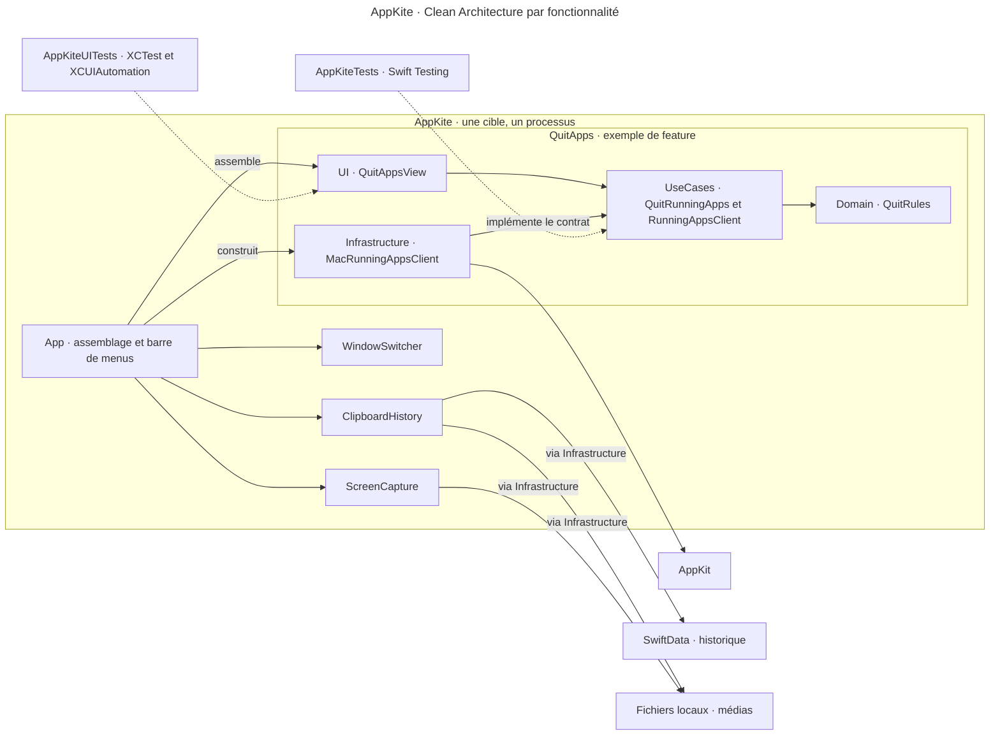

# AppKite · Guide technique et installation

Ce guide fixe l’architecture cible. Le projet Xcode existant sert de point de départ au socle.

## Vision

AppKite réunit quatre utilitaires dans une app native de barre de menus, gratuite, sans compte ni serveur. L’usage personnel précède la diffusion publique. Les quatre modules fonctionnent hors ligne et traitent les données sur le Mac.

- **Captures** — Captures et enregistrement d’écran, annotations, OCR et export. Référence fonctionnelle CleanShot X.
- **Presse-papiers** — Historique illimité et recherchable, aperçu, épingles, collections et exclusions. Référence fonctionnelle Paste.
- **Switcher** — Fenêtres individuelles, miniatures, raccourcis, styles, recherche et filtres. Référence fonctionnelle AltTab.
- **Fermeture d’apps** — Fermeture groupée, exceptions, confirmation et fermeture forcée. Référence fonctionnelle QuitAll.

Le brainstorm de chaque module précise la parité visée et les ajouts propres à AppKite. Le développement suit une démarche clean-room. Le code, les ressources et l’identité d’AppKite sont originaux.

## Decisions

| Décision | Choix | Justification |
| --- | --- | --- |
| Architecture | Stack A, Clean Architecture par fonctionnalité dans une cible d’application et un processus | Les quatre modules restent indépendants et leurs règles peuvent être testées séparément. |
| Interface | SwiftUI pour la barre de menus et les vues. AppKit pour les intégrations macOS qui le demandent | L’interface suit les composants natifs et chaque feature garde la maîtrise de son état. |
| Services | Services locaux en Swift. État d’interface sur `MainActor` et traitements lourds hors de l’acteur principal | Le switcher et la recherche doivent rester réactifs pendant les traitements média. |
| Persistance | SwiftData pour l’historique et les métadonnées du presse-papiers. Fichiers locaux pour les contenus volumineux | Le presse-papiers peut rechercher ses entrées sans charger les médias pour chaque résultat. |
| Accès | Aucun compte. App Sandbox désactivé pour AppKite, Hardened Runtime activé et permissions macOS à l’usage | Le module de fermeture doit interagir avec d’autres apps. Les protections et autorisations de macOS s’appliquent selon la fonction. |
| Hébergement et distribution | Exécution locale. Builds Xcode pour l’usage personnel, puis GitHub Releases et lien depuis le site personnel | Objectif d’hébergement à 0 €/mois. Signature Developer ID et notarisation via l’adhésion Apple existante. |

[Apple · Restrictions d’App Sandbox](https://developer.apple.com/documentation/security/protecting-user-data-with-app-sandbox) · [Apple · Hardened Runtime](https://developer.apple.com/documentation/xcode/configuring-the-hardened-runtime)

## Stack summary

- **Plateforme** — macOS uniquement, Apple Silicon, cible minimale macOS 26.0.
- **Compilation** — Xcode 27.2 (27B52), SDK macOS 27.2, compilateur Apple Swift 6.4.2 et mode de langage Swift 6.
- **Interface** — SwiftUI et Observation selon les besoins de l’état. AppKit lorsque l’intégration système ou la présentation l’exige.
- **API système** — ScreenCaptureKit et AVFoundation pour la capture et les médias, Vision pour l’OCR, `NSPasteboard` pour le presse-papiers, Accessibility et AppKit pour les interactions avec les fenêtres et les apps. Partage via le système.
- **Données** — SwiftData et fichiers locaux. L’iCloud privé reste une option à évaluer séparément.
- **Outillage** — Xcode, SDK et MCP officiels d’Apple. Consulter la documentation Apple via le MCP pendant le plan et l’implémentation avant d’utiliser une API. Toute dépendance tierce exige un accord préalable.

[Apple · Xcode 27.2](https://developer.apple.com/news/releases/?id=10292026a) · [Apple · Gestion des données SwiftUI](https://developer.apple.com/documentation/swiftui/managing-model-data-in-your-app)

### Compatibilité macOS 26 et 27

Utiliser les API publiques Apple actuelles qui répondent au besoin. Pour une API introduite après macOS 26.0, placer la vérification `#available` au point d’intégration, avec la version d’introduction précise et le repli prévu. La spec fixe le résultat attendu sur les deux versions et soumet les écarts à validation si les API publiques limitent la parité. [Apple · Disponibilité selon la version du système](https://developer.apple.com/documentation/xcode/running-code-on-a-specific-version)

### Tests et critères de vérification

| Vérification | Méthode |
| --- | --- |
| Logique et intégration | Swift Testing dans `AppKiteTests`. Couvrir les règles, les cas d’usage et les intégrations pertinentes au module. |
| Parcours d’interface | XCTest et XCUIAutomation dans `AppKiteUITests`. Commencer par les parcours du socle et de la barre de menus. |
| Réactivité | XCTest et Instruments. Mesurer le temps jusqu’à l’affichage de la liste du switcher et des premiers résultats de recherche. Cible inférieure à 200 ms au p95, avec 10 000 entrées mixtes et sous charge pendant un export long. |
| Compatibilité et permissions | Exécuter les scénarios pertinents sous macOS 26 et 27. Vérifier les replis, les chemins récents et le comportement quand une autorisation est accordée ou refusée. |

Le jeu de référence mélange textes, code, liens, images dont PNG et captures, audio, vidéo, fichiers et dossiers. Prévoir des enregistrements d’écran de quelques secondes et d’une heure.

Chaque spec définit ses critères de vérification et le plan identifie les tests associés. À l’assert, compiler avec `BuildProject`, exécuter les tests avec `RunAllTests` ou `RunSomeTests` et capturer les Previews pertinentes avec `RenderPreview`, via le MCP officiel Xcode. [Apple · Tests Xcode](https://developer.apple.com/documentation/xcode/testing) · [Apple · Tests de performance](https://developer.apple.com/documentation/xcode/writing-and-running-performance-tests)

## Architecture



`App` assemble les implémentations et expose les quatre fonctionnalités par la barre de menus. Dans chaque feature, `UI` appelle `UseCases`, qui applique les règles de `Domain` et s’appuie sur ses propres contrats. `Infrastructure` implémente ces contrats avec les API Apple et garde les détails de persistance et de compatibilité à la frontière du module.

La nomenclature suit la responsabilité. Une action porte un verbe comme `QuitRunningApps`, une règle porte un nom comme `QuitRules` et une vue porte le suffixe `View`. Chaque dossier et chaque protocole apparaît quand une responsabilité concrète le justifie. [Swift · Règles de nommage](https://www.swift.org/documentation/api-design-guidelines/)

## Folder structure

```text
AppKite/
├── AppKite.xcodeproj/
├── AppKite/
│   ├── App/
│   │   ├── AppKiteApp.swift
│   │   └── MenuBarView.swift
│   ├── Features/
│   │   ├── ScreenCapture/
│   │   ├── ClipboardHistory/       # SwiftData et fichiers dans Infrastructure/
│   │   ├── WindowSwitcher/
│   │   └── QuitApps/
│   │       ├── Domain/
│   │       │   └── QuitRules.swift
│   │       ├── UseCases/
│   │       │   ├── QuitRunningApps.swift
│   │       │   └── RunningAppsClient.swift
│   │       ├── Infrastructure/
│   │       │   └── MacRunningAppsClient.swift
│   │       └── UI/
│   │           └── QuitAppsView.swift
│   ├── Assets.xcassets/
│   ├── Info.plist
│   └── AppKite.entitlements
├── AppKiteTests/                   # Tests de logique et d’intégration par feature
├── AppKiteUITests/                 # Parcours XCTest et XCUIAutomation
├── aidd_docs/
│   ├── INSTALL.md
│   └── memory/
├── AGENTS.md                       # Entrée Codex
└── CLAUDE.md                       # Entrée Claude Code
```

## Install steps

1. Vérifier Xcode, Swift et le SDK avec `xcodebuild -version`, `xcrun swift --version` et `xcrun --sdk macosx --show-sdk-version`.
2. Ouvrir `AppKite.xcodeproj` dans Xcode. Sélectionner le schéma partagé `AppKite` et une destination Mac.
3. Vérifier l’accès dans les réglages Intelligence de Xcode. Dans Codex, confirmer qu’AppKite apparaît via `XcodeListWorkspaces`. Dans Claude Code, vérifier `xcode: xcrun mcpbridge` avec `claude mcp list`. Utiliser les skills Apple fournis par Xcode.
4. À l’implémentation du socle validé, appliquer les réglages de plateforme, de mode Swift, d’App Sandbox et de Hardened Runtime de ce guide. Conserver la cible d’application et les deux cibles de test.
5. À l’assert du socle, compiler et exécuter les tests du schéma `AppKite` via le MCP Xcode. Rendre les Previews pertinentes pour vérifier l’interface.

La connexion d’`AGENTS.md` et de `CLAUDE.md` à la même mémoire AIDD sera vérifiée séparément dans Codex et Claude Code à l’étape de connexion à l’IA.

## Audit summary

| Stack | Architecture et services | Interface | Persistance | Compte et accès | Distribution | Infrastructure | Verdict et décision |
| --- | --- | --- | --- | --- | --- | --- | --- |
| A · App modulaire | Un processus. OCR et exports traités dans l’app | SwiftUI et AppKit | SwiftData et fichiers locaux | Aucun compte. Permissions à la demande | GitHub Releases et site personnel | 0 €/mois | ⚠️ Retenue. Vérifier la réactivité sous charge et les replis. |
| B · App avec XPC | Deux processus. Service Swift embarqué pour l’OCR et les exports | SwiftUI et AppKit | SwiftData et fichiers locaux | Aucun compte. Permissions gérées par l’app | GitHub Releases et site personnel | 0 €/mois | ⚠️ Viable sous réserves. Échanges de fichiers, reprise et signature du service à valider. |

- **Fenêtres et Spaces** — Vérifier le filtre par Space et les miniatures de fenêtres minimisées avec les API publiques. Cadrer un affichage de repli pour les flux suspendus. [Apple · Notification de changement de Space](https://developer.apple.com/documentation/appkit/nsworkspace/activespacedidchangenotification) · [Apple · Capture de fenêtres](https://developer.apple.com/videos/play/wwdc2022/10155/)
- **Presse-papiers** — Définir dans la spec le comportement des exclusions lorsque l’origine d’une copie est incertaine. [Apple · NSPasteboard](https://developer.apple.com/documentation/appkit/nspasteboard/)
- **Distribution publique** — Signer avec Developer ID Application et notariser via l’adhésion Apple Developer Program existante. Vérifier le premier lancement depuis le ZIP et le DMG avec Gatekeeper activé et la conservation des autorisations après une mise à jour. [Procédure AppKite](memory/desktop.md#build-and-release)

L’audit couvre la documentation, le SDK et des contrôles ciblés du compilateur. Les résultats d’exécution sous les deux versions de macOS et les mesures de performance seront établis pendant les asserts.
