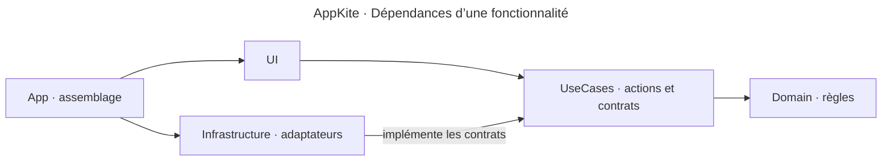

# Architecture

## Stack

- Swift natif et SwiftUI pour l’interface. AppKit pour la présentation ou l’intégration système quand la feature en a besoin.
- Une cible d’application et un processus, structurés en Clean Architecture par fonctionnalité. La configuration approuvée est dans le [guide technique](../INSTALL.md#decisions).

## How it fits together

## Key decisions

- `App` compose les dépendances. Chaque feature détient ses règles et les adaptateurs de ses effets système. Les règles s’expriment avec des types Swift et Foundation.
- L’état d’interface est isolé sur `MainActor`. Partir de `@State` pour l’état d’une vue et utiliser `@Observable` quand un état doit être partagé. L’OCR, l’encodage et la recherche s’exécutent hors de l’acteur principal.
- Nommer les cas d’usage par leur action, comme `QuitRunningApps`, les règles par leur rôle, comme `QuitRules`, et les vues avec le suffixe `View`. Introduire une couche ou un protocole quand sa responsabilité est concrète.

## Gotchas

- Les couches partagent une cible Xcode. La direction des dépendances et l’indépendance entre features se vérifient en revue.
