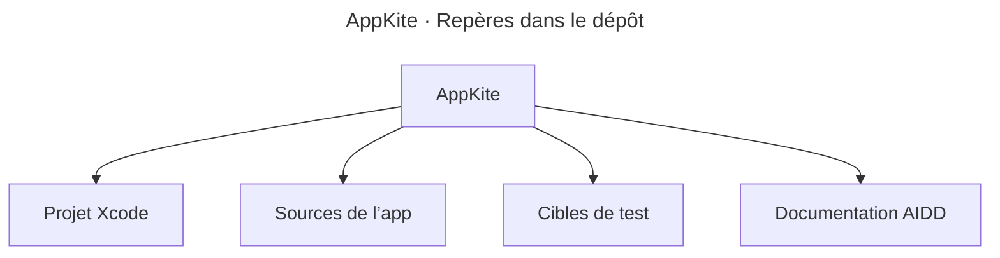

# Codebase Map

## Areas

- Le [projet Xcode](../../AppKite.xcodeproj/project.xcproj) contient la cible AppKite et ses deux cibles de test.
- Les [sources de l’app](../../AppKite/) comprennent le socle de barre de menus et la fonctionnalité d’historique. Le [guide technique](../INSTALL.md#folder-structure) décrit la structure cible.
- [AppKiteTests](../../AppKiteTests/) et [AppKiteUITests](../../AppKiteUITests/) — Cibles de test. Leurs rôles sont décrits dans [Testing](testing.md).
- [Documentation AIDD](../README.md) — Guide d’installation, mémoire et artefacts AIDD.

## Entry points

- [AppKiteApp.swift](../../AppKite/App/AppKiteApp.swift) — Point d’entrée `@main` et scène de barre de menus.
- [ClipboardHistoryComposition.swift](../../AppKite/App/ClipboardHistoryComposition.swift) assemble le stockage, le presse-papiers, le collage et le rendu des aperçus.
- [CollectClipboardHistory.swift](../../AppKite/Features/ClipboardHistory/UseCases/CollectClipboardHistory.swift) coordonne la collecte, l’indexation et le nettoyage des restitutions avec le collage.
- [ClipboardHistoryState.swift](../../AppKite/Features/ClipboardHistory/UI/ClipboardHistoryState.swift) gère le bandeau, la recherche et la sélection. [ClipboardPreviewRequests.swift](../../AppKite/Features/ClipboardHistory/UI/ClipboardPreviewRequests.swift) gère la file et le cache des aperçus visibles.
