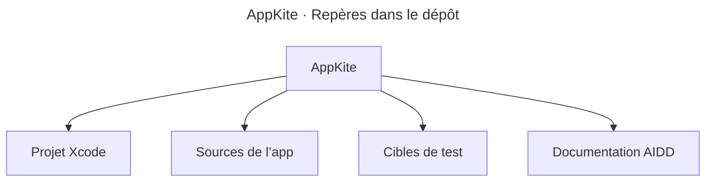

# Codebase Map

## Areas

- [Projet Xcode](../../AppKite.xcodeproj/project.xcproj) — Cibles et réglages actuels du modèle généré.
- [Sources de l’app](../../AppKite/) — Code du modèle SwiftUI. Les emplacements cibles sont décrits dans le [guide technique](../INSTALL.md#folder-structure).
- [AppKiteTests](../../AppKiteTests/) et [AppKiteUITests](../../AppKiteUITests/) — Cibles de test. Leurs rôles sont décrits dans [Testing](testing.md).
- [Documentation AIDD](../README.md) — Guide d’installation, mémoire et artefacts AIDD.

## Entry points

- [AppKiteApp.swift](../../AppKite/App/AppKiteApp.swift) — Point d’entrée `@main` et scène de barre de menus.
